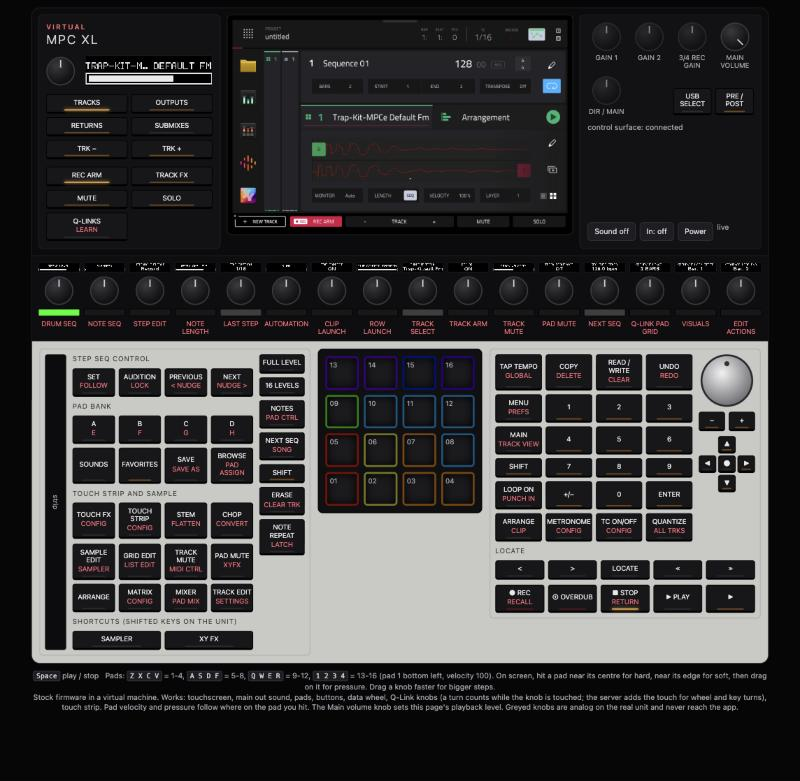
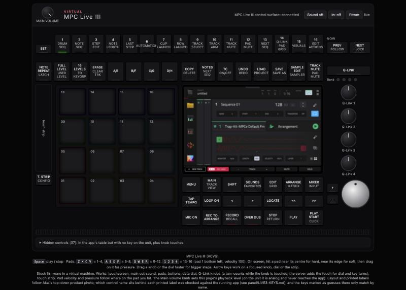

# Virtual MPC XL + MPC Live III

The stock Akai MPC Gen 2 firmware (3.10.0) running unmodified in a virtual machine on your
computer. Pick an MPC XL or an MPC Live III. The whole unit opens in your browser: live
touchscreen, pads, knobs, buttons, touch strip and sound.

Built by Henry Skillz as a sandbox. Break things in here before anything goes near real
hardware.





> **Unofficial project.** Not affiliated with, endorsed by or supported by inMusic Brands or
> Akai Professional. MPC, MPC XL and MPC Live are their trademarks. **No firmware and no
> factory content are in this repository.** You bring your own copy of the firmware update.

## What works

Checked on both units, 13 Nov 2026.

- The real MPC app boots, reaches the main screen and shuts down cleanly from the power key.
- Touchscreen: click and drag on the screen.
- Pads with velocity (hit the centre for hard, the edge for soft) and pressure. Pad colours
  come from the app.
- Every printed key. Q-Link knobs, data wheel, touch strip. The XL's 17 knob displays are drawn
  from what the app sends.
- Sound out of the main outs in your browser. Sound in from a test tone or your microphone,
  so sampling works.
- Internal storage and SD card. Projects save and come back after a reboot (reboot checked on the XL).
- An XL and a Live III can run side by side.

## What does not

- **Mods on real hardware.** Stock 3.10 only loads Akai-signed scripts. The lab can load your
  own code with `lab.py preload`, a real unit cannot (yet).
- **AIR plugins and paid content.** They are not in the update image.
- **Analog knobs** (gain, the XL's direct/main blend). They never reach the app. Main volume
  sets your browser's playback level only.
- **Some keys are unconfirmed.** The panels are matched to Akai's product photos and every key
  was pressed against the running app. A few keys show no reaction in an empty project, and
  the red shifted labels were not tested with Shift. See `panel/XL-KEYS.md` and
  `panel/LIVE3-KEYS.md`. Own a unit? See [Testers](#testers).

## Setup

You need:

- A Mac with Apple Silicon. That is what this was built and tested on. Linux and Windows
  may work (the Sample lab it grew from runs there) but are untested here.
- Python 3.9+, QEMU 9+ (`qemu-system-aarch64`, `qemu-img`), OpenSSH, Docker (build step only).
- The MPC Gen 2 3.10.0 update image. Get it through the inMusic Software Center or your own
  unit's online update. It is one image for the XL, Live III, One, Key 37 and Force Gen 2.

```bash
git clone https://github.com/Holla-Back-Entertainment/virtual-mpc-gen2.git && cd virtual-mpc-gen2
python3 tools/extract_update.py /path/to/MPC-3.10.0-Gen2-update.img   # checked against inputs.sha256
python3 lab.py build                                                   # once, in Docker
```

## Use

```bash
python3 lab.py run --headless                  # MPC XL       http://127.0.0.1:8865/
MODEL=acvg python3 lab.py run --headless       # MPC Live III http://127.0.0.1:8875/
python3 lab.py firstrun                        # tap past the welcome screens
python3 lab.py stop                            # clean shutdown (add MODEL=acvg for the Live III)
python3 lab.py status                          # what is running, on which ports
```

On the page:

- **Sound off / on**: plays the main out on your computer. **In**: off, test tone, or your mic.
- **Keyboard**: Space plays and stops. Z X C V, A S D F, Q W E R, 1 2 3 4 hit the pads.
- **Knobs and wheel**: drag up or down. Faster drag, bigger steps.
- **Power**: the unit's power key. The app asks before it shuts down.

More: `python3 lab.py ssh` gives a root shell on the unit, `lab.py preload LIB.so` loads your
own library into the app, `lab.py reset` starts fresh (`--nvme` also wipes internal storage).
Full reference, ports and limits: [README-GEN2.md](README-GEN2.md). How the control surface
talks to the app: [research/gen2-control-surface/FINDINGS.md](research/gen2-control-surface/FINDINGS.md).

## Testers

The sandbox is only as good as what it is checked against. If you own an MPC XL or Live III,
ten minutes on your unit closes the open questions:
[testers/XL-CHECKLIST.md](testers/XL-CHECKLIST.md),
[testers/LIVE3-CHECKLIST.md](testers/LIVE3-CHECKLIST.md). Nothing gets installed on your unit.
Send results through any of the links below.

## Credits

Built on [virtual-mpc-sample](https://github.com/orrpunk-art/virtual-mpc-sample) by
orrpunk-art (MIT), the virtual MPC Sample this started from. Its README is kept as
[README-SAMPLE.md](README-SAMPLE.md).

## Henry Skillz

DJ, producer, builder. Melbourne.

- Instagram: [@henryskillz](https://instagram.com/henryskillz)
- YouTube: [youtube.com/@henryskillz](https://youtube.com/@henryskillz)
- TikTok: [@henryskillzau](https://tiktok.com/@henryskillzau)
- Site: [henryskillz.com](https://henryskillz.com)
- MPC Sample mods: [henryskillz-mpc-sample-mod-kit](https://github.com/hmukhwana/henryskillz-mpc-sample-mod-kit)

## License

MIT. See [LICENSE](LICENSE). Kernel patches in `kernel/patches/` are GPL-2.0.
